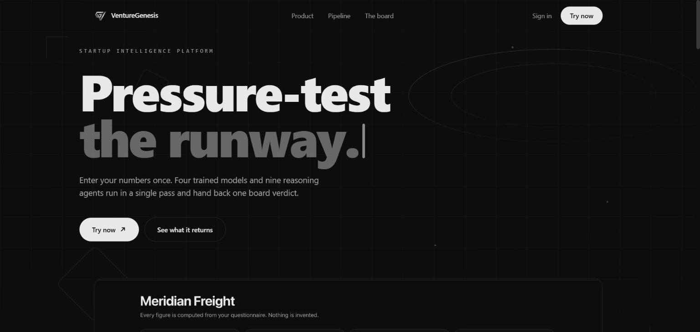
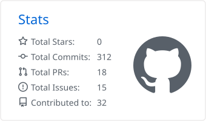
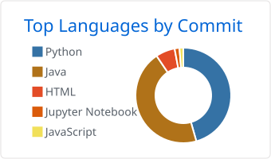

<h1 align="center">Sarvesh Pingale</h1>

  <strong>Computer Engineering Student · AI &amp; Full-Stack Developer</strong> 
  Building practical AI applications, reliable backend systems, and full-stack products.

  Lead AI Engineer Intern @ ReasonateAI · NASA Space Apps Challenge 2025 Local Winner &amp; Global Nominee · 7 Merged Open-Source PRs

  <a href="https://www.linkedin.com/in/sarvesh-pingale-8b9090299">LinkedIn</a> · <a href="mailto:pingalesarvesh5@gmail.com">Email</a> · <a href="https://github.com/search?q=author%3Asarv-tech+is%3Apr+is%3Amerged&amp;type=pullrequests">Merged Pull Requests</a>

---

## About

I build AI features end to end: the retrieval pipeline, the model integration, the API around it, and an interface people can actually use. Most recently I was **Lead AI Engineer Intern at ReasonateAI**, leading the development team on a vibe-coding platform and working on LLM deployment and fine-tuning open-source code models.

My projects focus on what goes wrong once an LLM meets real users: grounding answers in a user's own documents, streaming without breaking the UI, staying within context limits, handling rate limits, and keeping keys and model logic on the server. I also contribute to open source, mostly security fixes, tests and frontend work.

I'm looking for **software engineering, AI engineering and full-stack internships**.

---

## Featured Projects

### [NoteBot AI — Intelligent Document Retrieval System](https://github.com/sarv-tech/Intelligent-Document-Retrieval-System)
Ask questions about your own PDF notes and get answers grounded only in what the documents say.

- **Pipeline:** PyPDF2 text extraction → recursive chunking (300 chars, 50 overlap) → `BAAI/bge-small-en-v1.5` embeddings via FastEmbed → FAISS similarity search → answer generation through Groq.
- **Grounded answers:** the prompt restricts the model to retrieved context and makes it say it doesn't know when the notes don't cover the question.
- **Lightweight deployment:** FastEmbed (ONNX) replaces a PyTorch-based embedding stack so the app fits on Streamlit Community Cloud.

`Python` `LangChain` `FAISS` `FastEmbed` `Groq` `Streamlit` · [Live demo](https://intelligent-document-retrieval-system-vhgunrmheo8rycaxupxsbb.streamlit.app/)

Screenshot

 

### [VentureGenesis — AI Startup Intelligence Platform](https://github.com/sarv-tech/VG)
*Team project*

A virtual board of directors for founders: enter startup metrics once and get risk and funding scores, a revenue forecast, and a structured debate between AI board members.

- **ML layer:** trained failure-risk and funding-readiness models with SHAP explanations, plus Prophet time-series revenue forecasting and what-if scenario simulation.
- **Multi-agent board:** a LangGraph state graph runs specialist LLM agents (investor, strategist, risk analyst and others) through a debate and produces a board decision and executive report.
- **Full-stack structure:** FastAPI backend with SQLAlchemy and a pytest suite; Next.js 14 + TypeScript frontend with Clerk authentication; Docker and Render / Vercel deployment config.

`Python` `FastAPI` `LangGraph` `scikit-learn` `SHAP` `Prophet` `Next.js` `TypeScript` · [Live demo](https://venture-genesis.vercel.app)

Screenshot

 

### [MindfulMate — Conversational Wellness Companion](https://github.com/sarv-tech/MindfulMate)
A supportive chat app for everyday stress, with typed or spoken input and explicit safety rules for crisis situations.

- **Streaming chat** with Groq, keeping a sliding window of the last 10 messages so long conversations stay within the model's context limit.
- **Voice input** recorded in the browser and transcribed with Whisper (`whisper-large-v3`) before it enters the chat.
- **Robustness work:** strips model reasoning tags from the stream before display, surfaces API rate-limit (429) errors in the UI instead of failing silently, and fixes several Streamlit rendering and re-run loop issues.

`Python` `Groq` `Whisper` `Streamlit` · [Live demo](https://mindfulmate-xrz9svvq9bvq9ee7cd5fzv.streamlit.app/)

### [AI-Powered Code Reviewer](https://github.com/sarv-tech/AI-powered-Code-Reviewer)
Paste a code snippet and get a structured review covering correctness, readability, performance and security.

- **Full-stack split:** React 19 + Vite client with a code editor and syntax-highlighted Markdown output; Node.js / Express 5 REST API (`POST /ai/get-review`).
- **Layered backend:** routes, controllers and an AI service module, with the Gemini API key kept server-side.
- **Prompt design:** a system instruction fixes the review format (summary, then issue → suggestion → explanation) so the output is consistent across languages.

`JavaScript` `React` `Vite` `Node.js` `Express` `Gemini API` · [Live demo](https://ai-powered-code-reviewer-self.vercel.app/)

Screenshot

 

### [Land Registry DApp](https://github.com/sarv-tech/LAND-REGISTRY-DAPP-)
An Ethereum smart contract and web interface for registering land parcels and transferring ownership on-chain.

- **Access control in Solidity:** `onlyAdmin` and `onlyVerifiedUser` modifiers; only verified users can register land and only the current owner can transfer it.
- **Auditable history:** events for user verification, registration and ownership transfer.
- **Tested:** 10 Truffle tests covering the permission rules and failure cases (duplicate registration, non-owner transfer, unregistered parcels).

`Solidity` `Truffle` `Ganache` `Web3.js` `MetaMask`

---

## Experience

**Lead AI Engineer Intern** · ReasonateAI Pvt. Ltd · Remote · Jun 2026 – Sep 2026
- Led the development team building ReasonateAI, a vibe-coding platform that turns high-level requirements into working frontend components.
- Worked on AI infrastructure: LLM deployment and model integration on remote NVIDIA GPUs, with a backend using RAG, LangChain and LangGraph.
- Benchmarked open-source code models and fine-tuned Qwen2.5-Coder-3B with 2-bit quantization.
- Contributed to AI product development for a platform serving 25K+ users, across infrastructure, AI integration and interface work.

**AI Trainee Intern** · SKILLFI · Remote · Jun 2026 – Jul 2026
- Supported research and development of AI models, including data collection, preprocessing and feature engineering.
- Worked with the AI team on model performance and documented research findings.

**Generative AI Intern** · SURE ProEd · Remote · Dec 2024 – Jun 2025
- Built an AI-powered code reviewer with Gemini 1.5 Flash and a personal AI chatbot deployed on Streamlit.
- Developed and tested LLM-based integrations in Python with the OpenAI API and Postman; worked with prompt engineering, RAG, embeddings and tokenization.
- Trained predictive machine learning models on Kaggle diabetes datasets; training covered ML, deep learning, NLP, GANs, linear algebra and statistics.

---

## Open Source

Seven merged pull requests to community projects, most through GirlScript Summer of Code (GSSoC) 2026:

- **Security** · [python-mini-project #1580](https://github.com/steam-bell-92/python-mini-project/pull/1580) — stronger directory-boundary checks in a tar extractor to block path-traversal attempts.
- **Security** · [Edu #47](https://github.com/Himanshu1252/Edu/pull/47) — password-based student authentication with hashed passwords and a safe database migration.
- **Security** · [FinSight-AI #18](https://github.com/AakashRathore136/FinSight-AI/pull/18) — enforced email verification before access, in both the app and backend rules.
- **Testing** · [Waggle-mcp #432](https://github.com/Abhigyan-Shekhar/Waggle-mcp/pull/432) — Vitest unit tests for the Graph Studio filtering utilities.
- **Reliability** · [WinHome #482](https://github.com/DotDev262/WinHome/pull/482) — replaced an ICMP ping connectivity check with an HTTP check that works behind corporate firewalls and VPNs.
- **Frontend** · [CodeGraphContext #1264](https://github.com/CodeGraphContext/CodeGraphContext/pull/1264) — responsive redesign of the project's comparison section.
- **Feature** · [Voice-Driven Virtual Customer Success Manager #640](https://github.com/ArpitaVerma16/Voice-Driven-Virtual-Customer-Success-Manager/pull/640) — two-way commenting on complaints in the resolution workflow.

---

## Achievements &amp; Leadership

**NASA Space Apps Challenge 2025** · Local Winner, Global Nominee · Team DataDrift
- Frontend Engineer on [Messier Deep Sky Navigator](https://github.com/sarv-tech/Messier-Catalog-Navigator), an interactive deep-zoom sky map of all 110 Messier objects ([live](https://messier-catalog-nasa-space-challeng.vercel.app/)).

**Aspire Leaders Program** · Aspire Institute · 2025
- Selected as one of 5,463 finalists from 26,441 applicants in Cohort 2 of the 2025 program.
- Completed modules on personal and professional development, strengths-based leadership, problem-solving, trust, AI and community impact.
- Aspire Institute is an independent nonprofit co-founded by Harvard Business School faculty; program materials were developed with Harvard Business School and Harvard faculty.

---

## Certifications

- [**Agentic AI Certified Foundations Associate**](https://catalog-education.oracle.com/pls/certview/sharebadge?id=6F9DDA5432C5856EA8E7DE843FF2E6E63AC1FF779F7C8A687D0F93D46BD8B380) · Oracle · Jun 2026
- [**OCI 2025 Certified AI Foundations Associate**](https://catalog-education.oracle.com/pls/certview/sharebadge?id=6728816ACBACC83DC134183771B8D6F3666AB4FCD3960B7E752C2419C8782B98) · Oracle · Nov 2025
- [**Copado AI Certified**](https://success.copado.com/s/validate-credentials?StudentId=a3zP7000003YGbh) · Copado · Jun 2026
- [**Multicloud Network Associate**](https://www.credly.com/badges/954c6fbd-74a4-470d-bda3-cd79641c7af9) · Aviatrix Certified Engineer · Jan 2025
- [**Gemini Certified University Student**](https://edu.google.accredible.com/29aba5a6-7286-41ee-8fa5-adf5248b89f7) · Google · Oct 2025
- [**AWS Academy Graduate — Cloud Foundations**](https://www.credly.com/badges/4c344e28-5327-4397-b6da-38794d5535d6) (training badge) · Amazon Web Services · Apr 2026

Courses, programs and job simulations (14)

 

**Courses and micro-credentials**
- [**CS50's Introduction to Programming with Python**](https://certificates.cs50.io/b3187ff2-9391-43c1-bf70-6893ed7a39da.png?size=A4) · CS50 · Jul 2024
- [**Introduction to AI**](https://www.coursera.org/account/accomplishments/records/BGOI5MBQ6ZKS) · Google, via Coursera · Jul 2026
- [**AI Skills Fest 2026**](https://www.credly.com/badges/31d63945-bbef-447d-91b4-14f2871f3fa9) · Microsoft · Jun 2026
- [**Machine Learning Fundamentals Micro-Credential**](https://www.credly.com/badges/a4298bdb-0871-478f-995c-44b0d64e2050) · Alteryx · Dec 2024
- [**Generative AI for Educators**](https://skillshop.exceedlms.com/student/award/32bW83zS18m6f9UAtdivGQb8) · Google · Dec 2024
- [**Digital Skills: Artificial Intelligence**](https://www.futurelearn.com/certificates/3g43wm8) · Accenture, via FutureLearn · Oct 2024
- [**Introduction to HTML, CSS &amp; JavaScript**](https://coursera.org/share/d585b32f387d3532e07a2b2859d43451) · Coursera · Oct 2024
- [**WebML101: Google AI for Anyone**](https://courses.edx.org/certificates/07cbc78f18004fbd906671ec755a9277) · Google, via edX · Jul 2024

**Programs and recognitions**
- **AI-Integrated Leadership Program** · Aspire Institute · Dec 2025
- [**Aspire Leaders Program**](https://drive.google.com/file/d/1IiefyOVGvtLhtwpR0Thl_PmIekknhft4/view?usp=drivesdk) · Aspire Institute · May 2025
- [**Galactic Problem Solver**](https://drive.google.com/file/d/1_EnNNU8sbdIicuXK0IMnaxXAbrCOFSQY/view?usp=drivesdk) · NASA International Space Apps Challenge · Oct 2025

**Job simulations (Forage)**
- [**Accenture UK — Introduction to Technology Apprenticeship**](https://www.theforage.com/completion-certificates/ovyvuqqNRQKBjNxbj/EzKFRQ2oEA87PPjsL_ovyvuqqNRQKBjNxbj_5m8SNQNbxdTZmbe36_1759315635062_completion_certificate.pdf) · Oct 2025
- [**Datacom — Software Development**](https://forage-uploads-prod.s3.amazonaws.com/completion-certificates/gCW7Xki5Y3vNpBmnn/L3NcyCoAjLno9d3T9_gCW7Xki5Y3vNpBmnn_5m8SNQNbxdTZmbe36_1756935168007_completion_certificate.pdf) · Sep 2025
- [**Deloitte — Technology**](https://forage-uploads-prod.s3.amazonaws.com/completion-certificates/9PBTqmSxAf6zZTseP/udmxiyHeqYQLkTPvf_9PBTqmSxAf6zZTseP_5m8SNQNbxdTZmbe36_1756908378497_completion_certificate.pdf) · Sep 2025

---

## Tech Stack

**Languages** 

**AI, ML &amp; LLM Engineering** 

 
LLM APIs: Groq, Google Gemini, OpenAI · Techniques: RAG, fine-tuning, quantization, prompt engineering

**Web &amp; Backend** 

 
Also: Vite, REST API design

**Data &amp; Tools** 

 
Also: Vercel, Postman, Truffle, Ganache, MS PowerPoint, MS Excel

**Practices &amp; Skills** 
OOP · SDLC · Problem-solving · Communication

---

## GitHub Stats

  <picture>
    <source media="(prefers-color-scheme: dark)" srcset="profile-summary-card-output/github_dark/3-stats.svg">
    
  </picture>
  <picture>
    <source media="(prefers-color-scheme: dark)" srcset="profile-summary-card-output/github_dark/2-most-commit-language.svg">
    
  </picture>

Cards are regenerated daily by a GitHub Action in this repo. Language share is by commits, not by skill level.

---

  Contact: <a href="mailto:pingalesarvesh5@gmail.com">pingalesarvesh5@gmail.com</a> · <a href="https://www.linkedin.com/in/sarvesh-pingale-8b9090299">LinkedIn</a>

